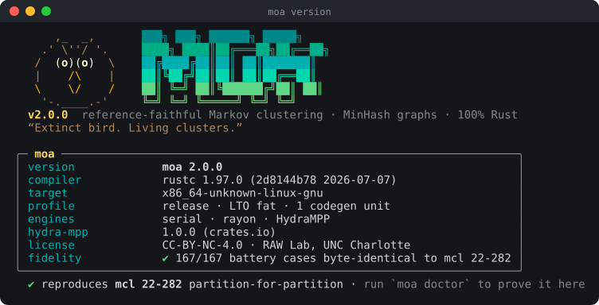
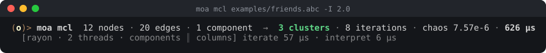
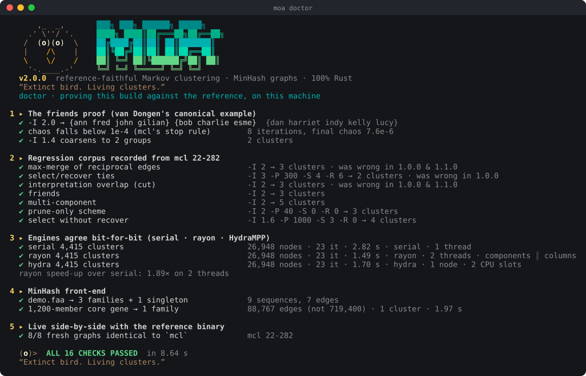

<p align="center">
  
</p>

<h1 align="center">moa</h1>

<p align="center">
  <b>The reference-faithful, parallel Markov clustering engine — and an alignment-free MinHash front-end.</b><br>
  100% Rust · rayon + <a href="https://crates.io/crates/hydra-mpp">HydraMPP</a> · laptop → workstation → SLURM cluster
</p>

<p align="center"><i>“Extinct bird. Living clusters.”</i></p>

```
      ,_  _,       ███╗   ███╗ ██████╗  █████╗
    .' \''/ '.     ████╗ ████║██╔═══██╗██╔══██╗
   /  (o)(o)  \    ██╔████╔██║██║   ██║███████║
   |    /\    |    ██║╚██╔╝██║██║   ██║██╔══██║
   \    \/    /    ██║ ╚═╝ ██║╚██████╔╝██║  ██║
    '-.____.-'     ╚═╝     ╚═╝ ╚═════╝ ╚═╝  ╚═╝
```

---

**moa** reimplements Stijn van Dongen's **MCL** (Markov Cluster Algorithm)
from scratch in Rust and reproduces the reference **`mcl 22-282`**
**byte-for-byte**, then runs it **up to 8.9× faster** on the same hardware.

| | |
|---|---|
| 🎯 **Exact** | **167 / 167** validation cases produce output files **byte-identical** to `mcl 22-282`. That holds under every engine, across weighted, duplicated, multi-component, tie-heavy, select/recover-heavy and overlap-producing graphs. |
| ⚡ **Fast** | Faster than `mcl -te 2` on every benchmark graph, from **1.16×** (one dense family) to **2.3×** (BLAST all-vs-all) to **8.9×** (pangenome-scale), at about the same memory. |
| 🧵 **Parallel two ways** | rayon over **components** *and* over **column blocks** inside large ones, chosen per iteration from the actual work. |
| 🌐 **Distributed** | The same binary scales across nodes with **HydraMPP**: `--hydra-host`, `moa worker`, or a single `--hydra-slurm "$SLURM_JOB_NODELIST"`. |
| 🧬 **Sequences in** | `moa cluster proteins.faa`: bottom-*s* MinHash, a **linear-time** candidate index that keeps 1,000+-member core-gene families whole, then MCL. No alignment. |
| 🩺 **Self-proving** | `moa doctor` re-derives the friends proof, replays a corpus recorded from the real `mcl`, checks every engine bit-for-bit, and compares against `mcl` live when it is installed. |

> **Upgrading from 1.0.0 or 1.1.0?** Both releases gave **wrong clusters** on real
> inputs: summed reciprocal BLAST hits, merged attractor systems, dropped ties,
> fragmented large families. **[BUGS.md](BUGS.md)** checks off all 24 bugs that
> shipped in 1.x, each with its reproduction (plus 2 caught during 2.0 development).

---

## Contents

- [Install](#install) · [Quick start](#quick-start) · [Proof](#proof-moa-doctor)
- [Validation against mcl](#validation-against-mcl) · [Performance](#performance)
- [How it works](#how-it-works) · [Engines & HydraMPP](#engines--hydrampp)
- [MinHash front-end](#the-minhash-front-end) · [CLI reference](#cli-reference)
- [Library use](#use-it-as-a-library) · [Reproduce everything](#reproduce-everything)
- [What changed since 1.x](#what-changed-since-1x) · [Layout](#project-layout) · [Credits](#credits)

---

## Install

```bash
git clone https://github.com/raw-lab/moa && cd moa
cargo build --release            # Rust ≥ 1.80 (tested on 1.97)
./target/release/moa doctor      # prove it on your machine
```

Three runtime dependencies: `rayon`, [`hydra-mpp`](https://crates.io/crates/hydra-mpp)
(engine only, no clap) and `serde`. No C, no BLAS, no GPU toolkit.

## Quick start

```bash
# Cluster a graph: one "labelA labelB [weight]" edge per line (mcl's --abc format)
moa mcl examples/friends.abc -I 2.0
#   dan     harriet kelly   indy    lucy
#   ann     fred    john    gilian
#   bob     charlie esme

# Drop-in for mcl: same flags, same output, same file
moa mcl blast.abc --abc -I 1.5 -te 16 -o clusters.tsv

# Sequences straight from FASTA (MinHash graph + MCL, alignment-free)
moa cluster examples/demo.faa -i 0.90

# Huge graph, whole SLURM allocation
moa mcl huge.abc --hydra-slurm "$SLURM_JOB_NODELIST" --hydra-cpus "$SLURM_CPUS_ON_NODE" -o out.tsv
```

<p align="center"></p>

The summary goes to stderr; clusters go to stdout or `-o`, one per line,
tab-separated, largest first, in exactly the order `mcl` writes them.

## Proof: `moa doctor`

<p align="center"></p>

`doctor` exits non-zero if anything fails, so it works as a CI gate or a
post-install check on a cluster. `--quick` runs a smaller version in under
two seconds.

---

## Validation against mcl

The original check (25 small graphs) never exercised **select**, **recover**,
**duplicate edges** or **interpretation overlap**: exactly where both 1.x
releases were wrong. The 2.0.0 battery is built to hit every one of those paths
(`scripts/gen_battery.py`) and is scored against the real `mcl 22-282` binary.

| category (cases) | what it stresses | 1.0.0 | 1.1.0 | ratio‑markov 0.5.2 | **2.0.0** |
|---|---|:-:|:-:|:-:|:-:|
| basic (25) | small ER / planted graphs | 25 | 25 | 10 | **25** |
| weighted (15) | log-normal weights | 15 | 15 | 3 | **15** |
| recip (15) | `a b w₁` + `b a w₂` + duplicates | **4** | **4** | 3 | **15** |
| loops (10) | self-loops in the input | 10 | 10 | 4 | **10** |
| multi (15) | 40 components, sizes 2–34 | 15 | 15 | 0 | **15** |
| tight (54) | `-S`/`-R` small: select & recover fire, many ties | **51** | n/a¹ | — | **54** |
| noselect (18) | prune-only / select-without-recover | 18 | n/a¹ | — | **18** |
| large (6) | 2,500 nodes, default scheme select fires | 6 | **5** | — | **6** |
| overlap (9) | graphs where mcl itself reports overlap | **0** | **0** | 0 | **9** |
| **partitions identical** | | **144 / 167** | **74 / 95** | **20 / 89** | **167 / 167** |
| **output byte-identical** | same file as `mcl -o` | 56 / 167 | — | — | **167 / 167**² |

¹ 1.1.0 has no `-R` option. ² under each of `--engine serial`, `rayon` and
`hydra`, and also over a real multi-process HydraMPP run (host + worker over TCP).
`ratio-markov` is the only other Rust Markov clusterer on crates.io. It is a
dense, argmax-interpreted *variant* of MCL rather than a port, so the
disagreement is expected; it was scored on the categories its dense matrices
can handle.

## Performance

Wall time and peak RSS, one run each on a **2-vCPU cloud VM** (7 GB RAM),
rustc 1.97, `mcl 22-282` from Ubuntu. Every moa row produced **the same
clusters as mcl**.

| graph | shape | `mcl -te 1` | **moa `-t 1`** | `mcl -te 2` | **moa** (rayon) | **moa** (hydra) | speed-up vs mcl -te 2 |
|---|---|--:|--:|--:|--:|--:|:-:|
| **pangen300k** | 300k genes, 23k families, 2.3M edges | 24.2 s · 271 MB | **3.5 s** · 178 MB | 19.2 s · 261 MB | **2.1 s** · 183 MB | 2.4 s · 210 MB | **8.9×** |
| **blast60k** | 60k proteins, 1.05M directed hits (both directions) | 15.9 s · 139 MB | **8.0 s** · 173 MB | 10.1 s · 136 MB | **4.5 s** · 188 MB | 4.8 s · 210 MB | **2.3×** |
| **dense15k** | one 15k-node component, degree ~40 | 48.6 s · 185 MB | **38.6 s** · 184 MB | 25.6 s · 186 MB | **19.9 s** · 289 MB | 20.3 s · 232 MB | **1.29×** |
| **family1500** | one 1,500-member core gene (MinHash graph) | 6.7 s · 36 MB | **5.0 s** · 36 MB | 3.4 s · 36 MB | **2.9 s** · 45 MB | 3.0 s · 51 MB | **1.16×** |

The old releases on the same machine and graphs:

| graph | 1.0.0 | 1.1.0 |
|---|---|---|
| dense15k | **killed by the OOM killer** at 5.9 GB | 97.7 s · 3.9 GB · **wrong clusters** |
| blast60k | 7.0 s · **wrong clusters** (summed reciprocal hits) | 18.0 s · **wrong clusters** |
| pangen300k | 6.4 s · 580 MB | 19.4 s · 398 MB |
| 1,500-member family (`moa cluster`) | **878 clusters** (expected 1) | **1,358 clusters** (expected 1) |

**Where the speed comes from**

- **One fused pass per column.** Compose → measure → prune/select/recover →
  rescale → chaos → inflate happen in one per-worker scratch buffer. The
  unpruned `M²` is never built (that is what killed 1.0.0).
- **Dense-or-sparse compose, per column.** When the predicted output is dense,
  a branchless 4×-unrolled scatter plus one sweep; otherwise a touched-row list.
  Both are bit-identical.
- **`f32` cells, `f64` accumulation.** This is exactly mcl's numeric model, and
  half the memory traffic of an `f64` matrix in a memory-bound kernel.
- **Components in parallel, then reconciled.** Work-stealing over components
  (largest first) plus nnz-balanced column blocks inside any big iterand.
  Converged components are detected as exact fixed points and frozen.
- **Parallel I/O.** Chunked parallel tokenising, a collision-resistant
  label hash, and a parallel sort-and-max-merge symmetrisation: 2.3M edges
  parse in about 0.6 s.

---

## How it works

```
 labelA labelB w ──▶ parse (parallel) ──▶ mirror + max-merge ──▶ components
                                                                     │
        ┌────────────── per component, in parallel ─────────────────┘
        ▼
   loops := column max, make stochastic                      (mclxAdjustLoops)
        │
        ▼  repeat ──────────────────────────────────────────────────────────┐
   for every column j (in parallel blocks when large):                      │
     compose   out = Σ_k M[k][j]·M[:,k]   f64 accumulate, f32 store         │
     measure   maxval, Σv² on the full column                 (vecMeasure)  │
     prune     keep v ≥ 0.99999/P                          (mclvSelectGqBar)│
     recover   n<R ∧ mass<pct → top-R of pre-prune, ties kept    (mclvKBar) │
     select    n>S → top-S, ties kept; nested recover from post-prune       │
     rescale   v /= mass                                                     │
     chaos     (maxval − Σv²)·n                                (expand.c:503)│
     inflate   v^I / Σv^I                                       (mclvInflate)│
   until max chaos < 1e-4 ──────────────────────────────────────────────────┘
        │   reconcile every component to the global iteration count
        ▼
   mclDag (bar = .999·self + .001·max, or self/1.01)
   attractor systems (largest first, lexicographic ties)
   flow closure → overlap cut to the first system → unattached nodes gathered
        │
        ▼
   clusters, written in mcl's order
```

**Why per-component is still exactly mcl.** Expansion, pruning and inflation
are column-local, and flow never crosses between components. The one global
coupling in mcl is its stop rule (`proc.c:463`): keep iterating *everything*
until the worst column in the whole graph has chaos below 1e-4. moa runs each
component to its own convergence in parallel, takes `T = max tᶜ`, advances
every component to exactly `T` iterations (re-checking the global criterion),
then interprets. The test `per_component_equals_whole_graph` asserts identical
clusters **and** iteration counts against a single whole-matrix run.

Every rule above is ported from the `mcl 22-282` source and cited in the code:
`src/kernel.rs` (expand.c, vector.c), `src/interpret.rs` (interpret.c,
clew/cat.c), `src/graph.rs` (alg.c `--abc` stream, matrix.c loops),
`src/mcl.rs` (proc.c, procinit.c).

---

## Engines & HydraMPP

All engines give bit-identical results. Pick one with `--engine`:

| engine | how it runs | when |
|---|---|---|
| `auto` *(default)* | `rayon` on one node; `hydra` when a `--hydra-host`/`--hydra-slurm` role is given | always a good choice |
| `rayon` | components ∥ (largest first) **and** column blocks ∥ inside iterands with ≥ 2,048 columns or ≥ 60k entries | one machine |
| `hydra` | small components packed into nnz-balanced **batch tasks**; big ones driven per iteration as **column-block tasks** over a shared `Arc` matrix | many machines, or to use HydraMPP locally |
| `serial` | one thread | reference, CI, equivalence checks |

**Multi-node by hand**

```bash
# coordinator
moa mcl huge.abc --engine hydra --hydra-host -o clusters.tsv
# on every worker node
moa worker --hydra-client 10.0.0.5 --hydra-cpus 32
```

**SLURM: one line, no manual workers**

```bash
#!/bin/bash
#SBATCH --nodes=8 --ntasks-per-node=1 --cpus-per-task=48
moa mcl huge.abc -I 1.5 -o clusters.tsv \
    --hydra-slurm "$SLURM_JOB_NODELIST" --hydra-cpus "$SLURM_CPUS_ON_NODE"
```

The head node `srun`s moa on every other node with `--hydra-client`, and moa
recognises that role **before** reading any input, so workers never touch the
input file. All `--hydra-*` flags are passed straight to
[HydraMPP](https://github.com/raw-lab/HydraMPP).

---

## The MinHash front-end

`moa cluster` (and `moa graph`, which only writes the graph) turns sequences
into a weighted graph without alignment:

1. **Read.** FASTA ids are the header up to the first space. Residues are
   upper-cased, and gaps, `*`, digits and CR are dropped, so soft-masked and
   aligned input sketch the same as plain input.
2. **Sketch.** Each sequence becomes a bottom-*s* MinHash of its *k*-mers
   (`k = 7`, `s = 256`), with a rolling k-mer code and partial selection. Runs
   in parallel.
3. **Candidates, in linear time.** An inverted index over sketch hashes
   (built by a parallel sort):
   - buckets of ≤ 64 members contribute **all pairs**;
   - larger buckets lay their members on a pseudo-random **ring** (6 neighbours
     per side), so the family stays connected;
   - plus **4 anchors** per large bucket, paired with every participant. The
     ring alone keeps a big family connected but turns its near-clique into a
     sparse expander, which MCL shatters. Anchors give it hub structure, so it
     comes out as **one** cluster.
4. **Score.** A pair becomes an edge when its Jaccard estimate clears the Mash
   cut-off for `--min-id` (`J = f/(2−f)`, `f = p^k`) and the shorter/longer
   length ratio clears `--len-cov`. Edges are weighted by **raw Jaccard**: 99%
   vs 80% identity is 0.93 vs 0.12 in Jaccard (8×), but only 1.2× in identity,
   and that contrast is what lets inflation separate paralogous subfamilies.
5. **MCL** as above.

Why `s = 256` and not less: the standard error of a bottom-*s* estimate near
`J` is `√(J(1−J)/s)`. At `s = 48` an ortholog sitting at the 95% cut-off is
rejected about half the time; at `s = 256`, under 2% of the time.

---

## CLI reference

```
moa <command> [options]

  mcl <graph|->      cluster a weighted graph — a faithful, parallel `mcl --abc`
  cluster <fasta|->  MinHash similarity graph over sequences, then MCL
  graph <fasta|->    write the MinHash similarity graph only (labelA labelB jaccard)
  doctor [--quick]   self-test against the reference, on this machine
  info               build, runtime, engines and every default
  version [--short]  version and build provenance
  worker             serve as a HydraMPP worker node (with --hydra-client)
  help [command]     overview, or details for one command
```

**MCL options** (names and defaults match `mcl -z`)

| flag | meaning | default |
|---|---|---|
| `-I <f>` | inflation; higher = finer clusters | 2.0 |
| `-P <n>` | prune entries below `0.99999/n` (0 = off) | 10000 |
| `-S <n>` | keep at most *n* entries per column (0 = off) | 1100 |
| `-R <n>` | recover up to *n* entries when pruning lost mass (0 = off) | 1400 |
| `-pct <n>` | recovery percentage | 90 |
| `-L <n>` | main loop length | 10000 |
| `--engine <e>` | `auto` · `rayon` · `hydra` · `serial` | auto |
| `-o <file>` | output (`-` = stdout) | stdout |
| `--stats <file>` | JSON run summary (iterations, chaos, overlap, timings…) | — |
| `-v`, `-q` | per-phase and per-iteration trace / silence | — |
| `--abc` | accepted for drop-in use (moa always reads label pairs) | — |

**MinHash options** (`cluster`, `graph`): `-i/--min-id 0.95`, `-k/--kmer 7`,
`-s/--sketch 256`, `--len-cov 0.70`, `--dense-bucket 64`, `--fanout 6`,
`--anchors 4`, `--edges <file>` (also write the graph).

**Global:** `-t/--threads <n>` (mcl's `-te` works too), `--color auto|always|never`
(`NO_COLOR` is honoured), `--hydra-host`, `--hydra-client <ip>`,
`--hydra-slurm <nodelist>`, `--hydra-cpus <n>`, `--hydra-port <p>`.

**Input rules** (as `mcl --abc`): undirected; duplicates and the two directions
of a pair merge by **max**; any input self-loop is reset to the column's
maximum. Two deliberate departures, both for invalid input: non-positive or
non-finite weights are **dropped with a warning** (mcl turns them into
meaningless negative "flow"), and a malformed weight such as `5x` is an
**error naming the line** (mcl reads the `5`).

---

## Use it as a library

```rust
use moa_core::{cluster_abc, Engine, MclParams};

let text = std::fs::read("graph.abc")?;
let p = MclParams { inflation: 1.8, ..Default::default() };
let (labels, out) = cluster_abc(&text, &p, &Engine::Rayon)?;
for c in &out.clusters {
    let names: Vec<&str> = c.iter().map(|&i| labels[i as usize].as_str()).collect();
    println!("{}", names.join("\t"));
}
println!("{} iterations, chaos {:.1e}, {} overlaps cut", out.iterations, out.chaos, out.overlap);
```

Lower levels are public too: `graph::{parse_abc, Graph, Csc}`, `mcl::{run, advance, CompRun}`,
`kernel::step_column`, `interpret::{dag, interpret}`, `minhash::{sketch_many, build_graph, CandidateIndex}`,
and `engine::{Engine, HydraEngine}`.

## Reproduce everything

```bash
cargo test --release                 # 29 tests: unit, integration, doctest
moa doctor                           # 16 live checks
scripts/validate.sh                  # 167-case battery vs mcl + byte-identity per engine
python3 scripts/gen_perf.py bench/   # benchmark graphs, then:
python3 scripts/perf.py bench/blast60k.abc "mcl=mcl {g} --abc -te 2 -o -" "moa=target/release/moa mcl {g}"
```

`scripts/find_regress.py` regenerates `src/regress.rs`. It searches for tiny
graphs on which an old binary disagrees with `mcl`, and records mcl's answer.

## What changed since 1.x

2.0.0 merges the two 1.x lines (1.0.0's engines, 1.1.0's component splitting
and candidate index), fixes everything they got wrong, and drops the vendored
HydraMPP for the published crate. Highlights; **[BUGS.md](BUGS.md)** has the
full checklist with reproductions:

- **Correct on real input:** max-merge of reciprocal hits · faithful
  interpretation with overlap cut · tie-inclusive select/recover · correct
  nested recover · strict stop rule · mcl's `float` cells.
- **Robust:** no more `M²` blow-up (5.9 GB → 185 MB) · large families stay whole ·
  `-k 0`, `inf`/`NaN` and malformed weights handled · FASTA case/garbage
  handling.
- **Fast & distributed:** fused kernel · components ∥ columns · HydraMPP
  host/worker/SLURM · zero-copy `Arc` iterands.
- **Removed:** 1.0.0's dense GPU path (O(n²), capped at 2,048 nodes, `f32`
  accumulation that could never match mcl).

See [CHANGELOG.md](CHANGELOG.md).

## Project layout

```
moa/
├── Cargo.toml · Cargo.lock · build.rs
├── README.md · BUGS.md · CHANGELOG.md · LICENSE
├── src/
│   ├── main.rs        CLI: mcl · cluster · graph · worker · info · version · help
│   ├── doctor.rs      the self-test
│   ├── lib.rs         pipelines: cluster_abc, cluster_fasta
│   ├── graph.rs       --abc parsing, max-merge symmetrisation, components, CSC
│   ├── kernel.rs      the fused column step (compose → … → inflate)
│   ├── mcl.rs         parameters, per-component iteration, global reconciliation
│   ├── interpret.rs   mclDag + mclInterpret + overlap cut
│   ├── engine.rs      serial · rayon · HydraMPP
│   ├── minhash.rs     sketches, linear candidate index with anchors, FASTA
│   ├── regress.rs     corpus recorded from mcl 22-282 (generated)
│   ├── synth.rs       deterministic test inputs
│   ├── art.rs         the face, the wordmark, colour, panels
│   └── util.rs        FxHash (+ SplitMix finaliser), epoch marker
├── tests/integration.rs
├── examples/          friends.abc · demo.faa
├── scripts/           validation battery, byte checks, benchmarks, ansi2svg
└── docs/              terminal renders used in this README
```

## Credits

- **MCL** is Stijn van Dongen's: *Graph Clustering by Flow Simulation* (PhD
  thesis, Utrecht, 2000) and *Graph Clustering Via a Discrete Uncoupling
  Process* (SIAM J. Matrix Anal. Appl. 30(1):121–141, 2008). moa is an
  independent Rust implementation validated against `mcl 22-282`; it contains
  no MCL source. Please cite van Dongen when you publish MCL clusterings.
- **HydraMPP** is by Jose L. Figueroa III and Richard Allen White III (RAW Lab):
  [crates.io/crates/hydra-mpp](https://crates.io/crates/hydra-mpp).
- **rayon** and **serde** are by their respective authors.

Part of the **RAW Lab** open-source toolkit · [rawlab.org](https://www.rawlab.org) ·
[github.com/raw-lab](https://github.com/raw-lab)

License: **CC-BY-NC-4.0**. See [LICENSE](LICENSE).
